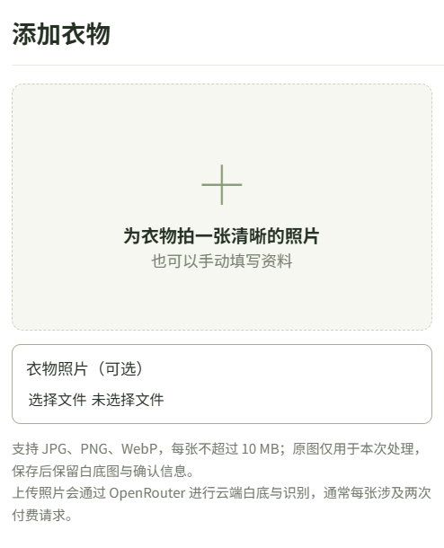
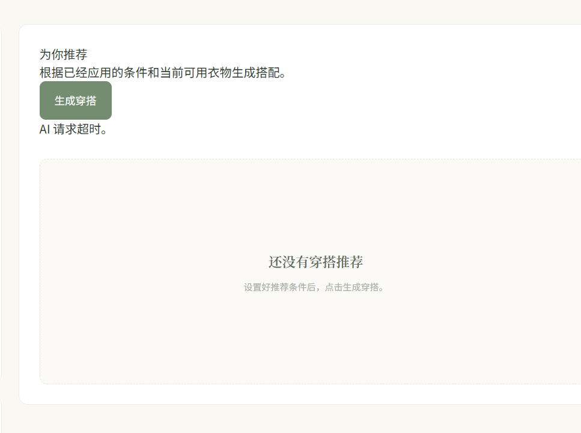
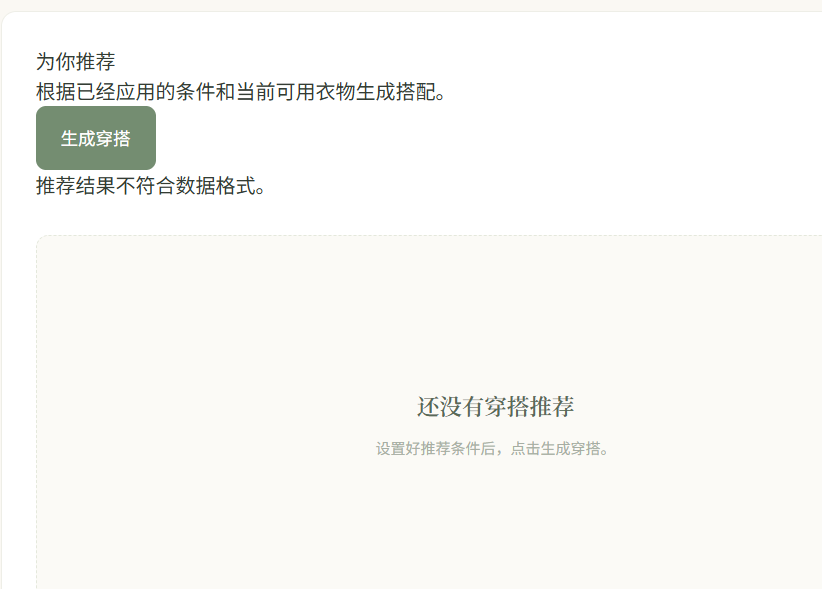

# 第 10 轮独立验收 · 07 → 01

2026-11-28，任务 #17，依赖 PR #40。被测版本为 codex/round-09-home 的 c147a82e02c738de162bf837ffd4295fcbb6b77d。交付给 01 在第 11 轮修复，07 在第 12 轮复验。

## 验收结论

真实衣物录入、首页生成及替换搭配已在 07 的 Windows 电脑通过。真实推荐页连续两次无法生成，影响首次生成后的反馈与隔离验收。建议带缺陷进入第 11 轮。

| 项目 | 状态 | 证据或影响 |
| --- | --- | --- |
| 实拍衣物与首页 | PASS | 上传单件、白底处理、识别、改名、保存刷新；首页生成、整套替换和指定单件替换通过。暂停衣物后，旧快照保留，新整套排除。首页也出现过间歇超时。 |
| 灵感、偏好与草稿 | PASS | 明确喜好产生归纳；手改和主动删除受保护。明确偏好及草稿刷新保留；推荐页草稿变化未改写首页搭配。 |
| 首次真实推荐 | FAIL | 同一衣橱及条件，首次超时；重试约 81 秒后显示“推荐结果不符合数据格式”，两次页面均无搭配。 |
| 真实单次反馈与双向隔离 | BLOCKED | 尚不能核验生成成功后新开一轮、旧反馈失效、生成失败保留旧搭配及反馈、以及首页操作后保留已应用天气与推荐结果。待真实推荐恢复后验证。 |
| 工程验证 | PASS | Node 24.22.3；类型检查与生产构建通过；单元测试 250 通过、1 跳过。 |
| Chrome 专项（模拟 AI） | PASS | 交接指定的两个测试文件共 9/9 通过。直接运行原配置还会选中同名真实 AI 用例；该配置禁用 Key，多出的用例返回 503。 |
| 默认 Chrome 回归 | FAIL | 63 项全部执行，42 通过、21 失败。12 项等待天气按钮、6 项等待旧界面文字、3 项等待本地白底完成。需依现行需求分类。 |

## 给 01 的四项反馈

1. **上传入口。** 添加衣物页最显眼的“＋”虚线框点击无反应，用户需另点下方“选择文件”。建议让框和按钮共用选图入口。复验时分别点击加号和文字，确认只弹出一次选择器，取消后也能继续操作。

   

2. **全身照的目标选择。** 用户想录入浅蓝紫长裤，预览中的白底图却是深色上衣，名称、类别、颜色描述的是下装，两项处理均显示完成。建议处理前选择目标类别，识别、白底和重试沿用同一选择。用有权使用的同一张全身照分别选择上衣和下装，核对图片、表单和保存后卡片。此次实测观察到保存前错配。组内交接包附件《04-全身照图文不一致.png》保留了同一屏的原图、白底结果和下装表单。
3. **等待体验。** 生成较慢时，用户难以判断请求是否仍在运行。建议显示真实等待状态、已等待时长，防止重复提交，完成或失败时及时更新提示。81 秒为验收人记录的一次失败请求耗时，见下一项第二次请求的结果截图。
4. **真实 AI 超时及格式校验。** 用有可用上衣、下装和鞋的衣橱进入推荐页，设置条件，点击生成；失败后原条件重试。预期生成有效搭配，实测见上表。请比较首页和推荐页请求，按请求记录阶段、耗时及校验失败原因。原始模型响应、首次精确耗时和具体失败字段未取得；根因待定位。

   首次生成后页面仍为空，提示 AI 请求超时。

   

   同条件重试约 81 秒后，页面提示格式错误。

   

## 复核与签收

从上述固定版本安装锁定依赖并启动 Node 服务。真实模型使用服务端环境配置；浏览器回归使用独立测试数据。人工验收端口为 3009。可按第 9 轮交接运行类型检查、Vitest、生产构建和 Playwright；专项复跑时精确指定 e2e/round7-preferences.spec.ts 与 e2e/round9-home.spec.ts。默认回归使用 playwright.config.ts。

第 11 轮请给出修复候选的固定 SHA。第 12 轮先复测推荐页生成、失败与重试，再验证真实反馈的轮次边界与双向隔离。公开交接仅记录观察和脱敏截图，完整运行报告供组内查阅。
